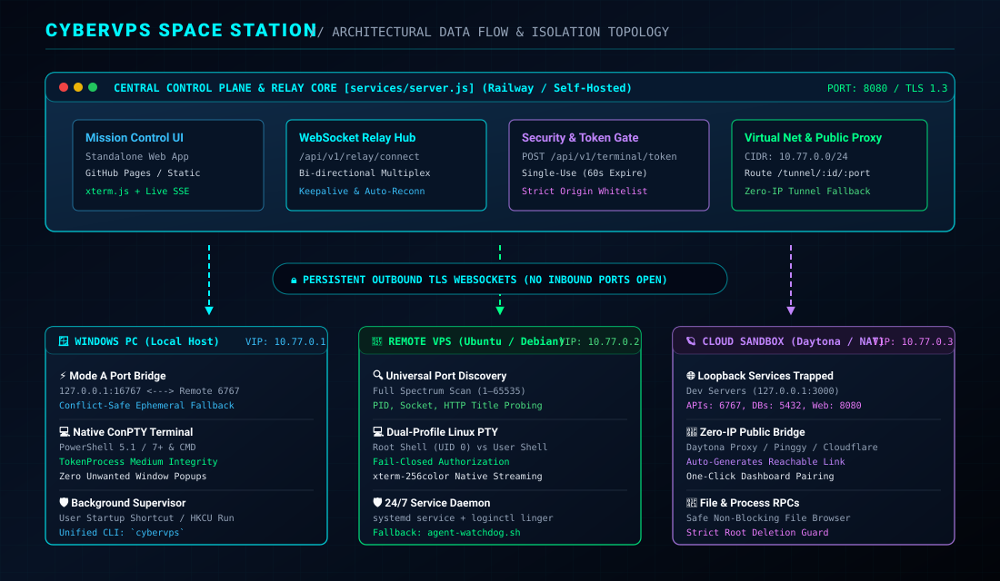

<p align="center">
  
</p>

<p align="center">
  <a href="https://github.com/cyberdrivepro/cybervps-space-station/blob/main/LICENSE"></a>
  <a href="https://nodejs.org"></a>
  <a href="https://www.python.org"></a>
  <a href="#-privilege--permission-matrix"></a>
  <a href="docs/SECURITY.md"></a>
  <a href="#-automated-verification-suite"></a>
  <a href="https://cyberdrivepro.github.io/cybervps-space-station/"></a>
</p>

<p align="center">
  <b>Your Remote Infrastructure. One Mission Control.</b><br>
  Connect remote machines behind NAT, firewalls, and restricted shells. Bridge loopback services (ports 1–65535) transparently to your local machine, inspect listening sockets, and stream interactive terminals with zero open inbound ports.
</p>

<p align="center">
  <a href="#-quick-start--zero-friction-installers">🚀 Quick Start</a> &bull;
  <a href="https://cyberdrivepro.github.io/cybervps-space-station/">🛰️ Live Dashboard</a> &bull;
  <a href="#-core-capabilities">✨ Features</a> &bull;
  <a href="#️-architecture--data-flow">🏗️ Architecture</a> &bull;
  <a href="#-mvp-status">📊 MVP Status</a> &bull;
  <a href="#️-unified-cli-reference-cybervps">🛠️ CLI Reference</a> &bull;
  <a href="docs/SECURITY.md">🔒 Security</a> &bull;
  <a href="docs/TROUBLESHOOTING.md">🩺 Diagnostics</a>
</p>

---

<p align="center">
  
</p>

---

## 📑 Table of Contents

- [🛰️ The Problem & The Mission](#️-the-problem--the-mission)
- [🌟 Core Capabilities](#-core-capabilities)
- [📊 Feature & Verification Matrix](#-feature--verification-matrix)
- [🏗️ Architecture & Data Flow](#️-architecture--data-flow)
- [🛡️ MVP Status: Honest & Specific](#️-mvp-status-honest--specific)
- [🔒 Privilege & Permission Matrix](#-privilege--permission-matrix)
- [🚀 Quick Start & Zero-Friction Installers](#-quick-start--zero-friction-installers)
  - [🐧 Linux & Remote VPS](#-linux--remote-vps-ubuntu-debian-centos-termux-daytona)
  - [🪟 Windows PowerShell 5.1 & 7+](#-windows-powershell-powershell-51--powershell-7)
  - [💻 Windows Command Prompt (CMD)](#-windows-command-prompt-cmd)
  - [🐳 Docker & Compose](#-docker-compose-deployment)
  - [🛠️ Manual Development Setup](#️-manual-development-setup)
- [🛠️ Unified CLI Reference: `cybervps`](#️-unified-cli-reference-cybervps)
- [🌐 Dashboard & Zero-IP Pairing Workflow](#-dashboard--zero-ip-pairing-workflow)
- [⚙️ Configuration Reference](#️-configuration-reference)
- [🔒 Security, Authentication & CSWSH Defense](#-security-authentication--cswsh-defense)
- [🧪 Automated Verification Suite](#-automated-verification-suite)
- [🩺 Practical Troubleshooting](#-practical-troubleshooting)
- [🗺️ Project Roadmap](#️-project-roadmap)
- [🤝 Contributing & License](#-contributing--license)

---

## 🛰️ The Problem & The Mission

When you develop or host services on remote servers (Ubuntu, Debian, cloud sandboxes like Daytona, Railway, Docker containers, or internal Windows machines), services typically bind to loopback:
- `127.0.0.1:3000` (Node/Next.js dev servers)
- `127.0.0.1:5432` (PostgreSQL databases)
- `127.0.0.1:6767` (Internal APIs)
- `127.0.0.1:8080` (Microservice endpoints)

Traditional remote access fails when:
1. **Firewalls block incoming ports**: Cloud providers, NAT gateways, and office networks block inbound traffic.
2. **Dynamic or missing public IPs**: Machines behind carrier-grade NAT (CGNAT) or restricted shells have no reachable external IP.
3. **SSH port forwarding is fragile**: SSH tunnels drop on network blips, require manual port definitions, and cannot dynamically discover listening endpoints.

### 💡 The CyberVPS Solution
**CyberVPS Space Station** reverses the connection model. The host agent dials **outbound** via encrypted WebSockets (TLS 1.3) to your central control plane. 
- **Mode A (Universal Port Bridge)**: Maps any remote port (1–65535) directly to your local PC at `127.0.0.1:<port>` with automatic conflict resolution.
- **Mode B (Virtual Private Mesh)**: Provisions a private subnet (`10.77.0.0/24`) for IP-level communication.
- **Interactive Web Terminal**: Delivers native PTY / ConPTY terminal streaming in the browser with single-use authentication tokens and process privilege de-elevation.

---

## 🌟 Core Capabilities

### 🌉 MODE A: Universal TCP Port Bridge (Ports 1–65535)
- **Local PC Loopback Mapping**: Map ANY remote port (1 to 65535) directly to your Windows or Linux PC on `127.0.0.1:<local_port>`.
- **Transparent Tooling**: Open `http://127.0.0.1:16767` in Chrome, Postman, DBeaver, or VS Code to communicate directly with `localhost:6767` on the remote server.
- **Conflict-Safe Binding**: If a requested local port is already occupied, the bridge automatically catches `EADDRINUSE`, allocates the next available ephemeral port, and updates the UI without interrupting existing programs.
- **Pure Userspace**: Runs without root on Linux or Administrator privileges on Windows.

### 🪐 MODE B: Virtual Private Network (10.77.0.0/24 Mesh Network)
- **Virtual IP Addressing**: Allocates dedicated Virtual IPs (e.g., `10.77.0.1`, `10.77.0.2`, `10.77.0.3`) to every enrolled machine.
- **Private Subnet Routing**: Enables IP-level communication between compatible machines over an encrypted data plane.
- **Privilege-Aware Detection**: Uses kernel TUN/TAP adapters when elevated privileges are available, and gracefully falls back to Mode A on unprivileged hosts.

### 🔍 Universal All-Port & Process Discovery Engine
- **Full-Spectrum Socket Scanning**: Dynamically identifies active TCP and UDP listening sockets across all numeric ports (1 to 65535).
- **Process & Socket Attribution**: Resolves Process IDs (PIDs), process names, listening state, and protocols.
- **HTTP/WS Service Probing**: Safely probes loopback endpoints with strict timeouts to extract HTTP status codes, page titles, and WebSocket readiness.

### 💻 Dual-Profile Interactive Terminal (PTY / ConPTY)
- **Linux Pseudo-Terminal**: Native `pty.openpty()` integration supporting root vs. unprivileged user execution profiles.
- **Windows ConPTY Subsystem**: High-performance pseudo-console engine.
- **TokenProcess De-Elevation**: Automatically strips administrative tokens down to Medium Integrity (`0x2000`) for standard user terminals, preventing accidental privilege escalation.
- **Zero Desktop Windows**: Operates silently in the background without unwanted console window popups.

### 🛡️ 24/7 Self-Healing Supervisor
- **Zero-Dependency Agent**: Universal Python 3 agent requires only the Python standard library—no `pip install` required.
- **Service Integration**: Registers with `systemctl` on Linux (with `loginctl enable-linger` for persistent user sessions) and startup hooks on Windows.
- **Watchdog Supervisor**: Background daemon auto-restarts upon network interruption or system reboot.

---

## 📊 Feature & Verification Matrix

| Capability | Status | Implementation Evidence | Platform Scope |
|---|:---:|---|---|
| **Outbound TLS Relay Transport** | ✅ Verified | `services/server.js`, `agent/universal-agent.py` | Linux, Windows, macOS, Sandboxes |
| **Mode A: TCP Port Bridge (1-65535)** | ✅ Verified | Verified in test suite (`TEST 6 & 7`) | All platforms (pure userspace) |
| **Conflict-Safe Port Resolution** | ✅ Verified | Tested in `TEST 8` (resolves occupied ports) | Windows & Linux clients |
| **Dynamic Port Discovery** | ✅ Verified | Tested in `TEST 5 & 13` (spectrum 1-65535) | Linux & Windows hosts |
| **Interactive Terminal (PTY/ConPTY)** | ✅ Verified | Tested in `TEST 21 & 22` with offline xterm.js | Linux (PTY) & Windows (ConPTY) |
| **Single-Use Terminal Token Flow** | ✅ Verified | Tested in `TEST 21` (replay rejection) | All browser dashboards |
| **CSWSH Origin Validation** | ✅ Verified | Explicit allowlist enforced in `services/server.js` | All WebSocket endpoints |
| **Windows Token De-Elevation** | ✅ Verified | Verified in `test-agent-security.py` (RID 0x2000) | Windows (Admin -> Medium User) |
| **Host Telemetry Stream (SSE)** | ✅ Verified | Tested in `TEST 17` (2-second interval) | All platforms |
| **File Manager RPC (Root Guard)** | ✅ Verified | Tested in `TEST 18` (prevents `/` deletion) | Linux & Windows hosts |
| **Mode B: Kernel TUN Mesh Subnet** | 🟡 Limited | Verified on root hosts; falls back on non-root | Requires root / TUN driver |
| **Peer-to-Peer Direct WireGuard** | 🗺️ Planned | Under active design (Milestone 4) | Planned for future release |

*Legend: ✅ Implemented & Verified with automated tests &bull; 🟡 Partially Implemented / Privilege-Limited &bull; 🗺️ Planned Roadmap Item*

---

## 🏗️ Architecture & Data Flow

<p align="center">
  
</p>

### The 5-Step Connectivity Workflow

```
1. DEPLOY HUB        2. AGENT OUTBOUND       3. AUTO-DISCOVERY       4. TOKEN HANDSHAKE       5. LOCAL BRIDGE
   [Server.js]  <=======  [Agent.py]    =======> [Scan Sockets]  <=======  [Dashboard]   =======> [Localhost:16767]
(Railway/Host)        (TLS WebSocket)           (PIDs 1-65535)          (Single-Use Token)       (Direct TCP Pipe)
```

1. **Deploy Hub**: Launch the control plane (`services/server.js`) on your cloud server or container.
2. **Agent Outbound Connect**: The remote host agent executes and dials *outbound* to `wss://<hub>/api/v1/relay/connect`. No incoming firewall ports are needed on the agent.
3. **Auto-Discovery**: The agent catalogs loopback listening ports (`22`, `3000`, `6767`, `8080`) and reports system telemetry.
4. **Token Handshake**: When the user requests a terminal, the dashboard acquires a single-use token valid for 60 seconds.
5. **Local Bridge**: Traffic from your local browser or terminal is multiplexed over the WebSocket relay directly to the remote service.

For deeper technical specifications, see [docs/ARCHITECTURE.md](docs/ARCHITECTURE.md).

---

## 🛡️ MVP Status: Honest & Specific

CyberVPS Space Station is currently an **Active, Production-Capable MVP**.

### ✅ Fully Implemented & Test-Verified
- **Control Plane & Relay Core**: Node.js WebSocket relay multiplexing command frames, telemetry, and TCP streams.
- **Mode A Port Forwarding**: Userspace TCP bridging for all ports 1–65535 with conflict-safe ephemeral port resolution.
- **Interactive Terminal**: Real-time bi-directional PTY/ConPTY streaming with xterm.js vendor bundles.
- **Security Hardening**:
  - CSWSH origin allowlist rejecting untrusted browser origins (`403`).
  - Single-use, machine-scoped 60-second terminal tokens (`POST /api/v1/terminal/token`).
  - Windows `TokenProcess` verifying `TokenIntegrityLevel` = `0x2000` (Medium) and `TokenElevation` = `False`.
  - Non-privileged agents fail-closed when elevated profiles are requested.
- **File & Process RPCs**: Non-blocking file browser with root directory deletion guards (`400`).

### 🟡 Known Scope & Platform Boundaries
- **Mode B Kernel Networking**: Requires native TUN/TAP adapter drivers (`root` on Linux, `Administrator` with Wintun on Windows). On unprivileged hosts, the system gracefully falls back to Mode A.
- **Process Enumeration**: Standard user agents can only inspect processes owned by that user account on Windows and Linux.
- **Zero-IP Public Tunnels**: Relies on third-party tunnel providers (Pinggy, Cloudflare, Daytona) when running inside isolated sandboxes.

---

## 🔒 Privilege & Permission Matrix

| Feature | Linux (Non-Root) | Linux (Root) | Windows (Standard User) | Windows (Administrator) |
|---|:---:|:---:|:---:|:---:|
| **Outbound TLS Connection** | ✅ Full | ✅ Full | ✅ Full | ✅ Full |
| **Mode A: Port Bridge (1–65535)** | ✅ Full | ✅ Full | ✅ Full | ✅ Full |
| **Port Discovery (visible sockets)** | ✅ Full | ✅ Full | ✅ Full | ✅ Full |
| **Interactive Terminal (PTY / ConPTY)**| ✅ Full | ✅ Full | ✅ Full | ✅ Full |
| **Process Inspection** | ⚠️ User PIDs | ✅ All PIDs | ⚠️ User PIDs | ✅ All PIDs |
| **Mode B: Kernel TUN Adapter / VPN** | ⚠️ Userspace fallback | ✅ Native TUN | ⚠️ Userspace fallback | ✅ Wintun Driver |
| **24/7 Autostart Supervisor** | ✅ `systemctl --user` | ✅ System service | ✅ User Startup / HKCU | ✅ Windows Service |

---

## 🚀 Quick Start & Zero-Friction Installers

### ⚡ Universal 1-Line Bootstrap Installers (No Git Required)

#### 🐧 Linux & Remote VPS (Ubuntu, Debian, CentOS, Termux, Daytona):
```bash
curl -fsSL https://raw.githubusercontent.com/cyberdrivepro/cybervps-space-station/main/install.sh -o install.sh && sh install.sh
```

#### 🪟 Windows PowerShell (PowerShell 5.1 & PowerShell 7+):
> *Tested and compatible with both legacy Windows PowerShell 5.1 and modern PowerShell 7+ without `&&` operator syntax errors:*
```powershell
$ProgressPreference = 'SilentlyContinue'; [Net.ServicePointManager]::SecurityProtocol = [Net.SecurityProtocolType]::Tls12; $installer = Join-Path $env:TEMP 'cybervps-install.ps1'; Invoke-WebRequest -UseBasicParsing -Uri 'https://raw.githubusercontent.com/cyberdrivepro/cybervps-space-station/main/install.ps1' -OutFile $installer; & powershell.exe -NoProfile -ExecutionPolicy Bypass -File $installer; Remove-Item $installer -Force -ErrorAction SilentlyContinue
```

#### 💻 Windows Command Prompt (CMD):
> *Safe from any working directory, including `C:\Windows\system32` Administrator prompts (downloads cleanly to `%TEMP%` without curl error 23):*
```cmd
curl.exe -fSL --retry 3 "https://raw.githubusercontent.com/cyberdrivepro/cybervps-space-station/main/install.cmd" -o "%TEMP%\cybervps-install.cmd" && call "%TEMP%\cybervps-install.cmd"
```

---

### 🐳 Docker Compose Deployment

Run the complete control plane stack with Docker Compose:

```bash
git clone https://github.com/cyberdrivepro/cybervps-space-station.git
cd cybervps-space-station/deploy/compose
docker compose up -d
```
The Space Station Control Plane will be active on `http://localhost:8080`.

---

### 🛠️ Manual Development Setup

```bash
# 1. Clone repository
git clone https://github.com/cyberdrivepro/cybervps-space-station.git
cd cybervps-space-station

# 2. Install dependencies (Node.js 18+)
npm install

# 3. Start control plane
npm start

# 4. In a separate terminal, launch the host agent
python agent/universal-agent.py --server http://localhost:8080 --token cvps_enroll_master_token
```

---

## 🛠️ Unified CLI Reference: `cybervps`

Once installed, use the cross-platform `cybervps` CLI across Windows, Linux, and macOS:

```
Usage: cybervps <command> [options]
```

| Command | Purpose | Example |
|---|---|---|
| `cybervps start` | Start host agent in background (24/7 connection) | `cybervps start --server https://station.example.com` |
| `cybervps stop` | Gracefully stop background agent | `cybervps stop` |
| `cybervps restart` | Restart running agent daemon | `cybervps restart` |
| `cybervps status` | Inspect agent health, fleet enrollment, and URLs | `cybervps status` |
| `cybervps doctor` | Run comprehensive system diagnostics and network tests | `cybervps doctor` |
| `cybervps logs` | View real-time agent execution and streaming logs | `cybervps logs -f -n 50` |
| `cybervps config` | View or update backend target URL and tokens | `cybervps config set server_url <URL>` |
| `cybervps server` | Manage central control plane (start/stop) | `cybervps server start` |
| `cybervps update` | Pull latest updates from GitHub repository | `cybervps update` |
| `cybervps uninstall`| Remove background service, startup shortcuts, and logs | `cybervps uninstall` |
| `cybervps version` | Print CLI version and runtime environment | `cybervps version` |

---

## 🌐 Dashboard & Zero-IP Pairing Workflow

CyberVPS Space Station features a decoupled frontend and backend:
- **Standalone Dashboard**: Hosted live on GitHub Pages at **[https://cyberdrivepro.github.io/cybervps-space-station/](https://cyberdrivepro.github.io/cybervps-space-station/)**.
- **Central Control Plane**: Deployed on Railway or self-hosted (e.g. `https://cybervps-space-station.up.railway.app`).

### 🔗 One-Click Instant Pairing
When your control plane starts, it prints an authenticated pairing URL:
```text
https://cyberdrivepro.github.io/cybervps-space-station/?backend=https://your-backend.up.railway.app&pair=YOUR_PAIRING_KEY
```
Clicking this URL connects your browser dashboard to your remote backend with live telemetry, node inventory, and interactive terminal access.

---

## ⚙️ Configuration Reference

### Control Plane Environment Variables

| Variable | Default | Purpose |
|---|---|---|
| `PORT` | `8080` | Port for the HTTP and WebSocket server. |
| `PAIRING_KEY` | *(Auto-generated)* | Cryptographic master key for client pairing and agent enrollment. |
| `ALLOWED_ORIGINS` | *(Allowlist)* | Comma-separated list of additional trusted WebSocket origins. |
| `ENABLE_TUNNEL` | `true` | Automatically attempts to establish public HTTPS tunnel if needed. |
| `VIRTUAL_SUBNET` | `10.77.0.0/24` | CIDR block for Mode B virtual IP address assignment. |

For detailed client configuration file parameters, see [docs/CONFIGURATION.md](docs/CONFIGURATION.md).

---

## 🔒 Security, Authentication & CSWSH Defense

CyberVPS Space Station enforces defense-in-depth principles:

1. **Cross-Site WebSocket Hijacking (CSWSH) Defense**:
   All WebSocket connections are validated against an explicit trusted Origin allowlist (`cyberdrivepro.github.io`, Railway deployment, localhost). Requests from unauthorized origins are rejected with `HTTP 403 Forbidden`.
2. **Single-Use Terminal Tokens**:
   Terminal WebSocket connections require a short-lived token acquired via authenticated `POST /api/v1/terminal/token`. Direct pairing keys on WebSocket streams are rejected (`HTTP 401`). Tokens expire in 60 seconds and are invalidated on first connection.
3. **Windows Token De-Elevation**:
   When launching standard user shells from an elevated agent, Win32 tokens are stripped to Medium Integrity (`0x2000`) and administrative privileges are disabled.
4. **Root Deletion Protection**:
   Remote file management APIs validate paths and reject any attempts to delete root directories (`/`) with `HTTP 400 Bad Request`.

For the complete security disclosure and threat model, see [docs/SECURITY.md](docs/SECURITY.md).

---

## 🧪 Automated Verification Suite

Run the full end-to-end verification suite across the entire stack:

```bash
# Run all 23 integration and control plane tests
node tests/run-all-tests.js

# Run agent security and process token tests
python tests/test-agent-security.py
```

### Verified Test Cases:
- **Test 1**: Control Plane Health & Virtual Network Configuration (`10.77.0.0/24`)
- **Test 2**: All-Port Numeric Boundaries (Port 0 rejected, Port 65535 accepted)
- **Test 3**: Target Service loopback activation on `127.0.0.1:6767`
- **Test 4**: Mode B Virtual IP allocation (`10.77.0.64`)
- **Test 5**: Dynamic port discovery across low, mid, and high ports
- **Test 6**: Mode A Port Bridge mapping (`127.0.0.1:16767 <-> :6767`)
- **Test 7**: Bidirectional HTTP data transmission through local Windows port
- **Test 8**: Conflict-safe port resolution on occupied ports
- **Test 9–14**: Access endpoints, CLI execution, and HTTP relay fallback
- **Test 15**: Durable state persistence across server restarts
- **Test 16–20**: Telemetry SSE stream, File RPCs, Process RPCs, SFTP gateway
- **Test 21**: Terminal authentication, single-use token acquisition, and CSWSH origin rejection
- **Test 22**: Windows background terminal with zero unwanted desktop windows
- **Test 23**: Agent privilege fail-closed and duplicate instance prevention

---

## 🩺 Practical Troubleshooting

| Symptom | Probable Cause | Recommended Fix |
|---|---|---|
| `EADDRINUSE (Port occupied)` | Another local app is using port `16767` or `8080` | CyberVPS auto-resolves to an ephemeral port. Inspect with `netstat -ano`. |
| `PowerShell execution policy` | Windows execution policy set to Restricted | Run: `powershell.exe -NoProfile -ExecutionPolicy Bypass -File .\install.ps1` |
| `CMD curl error 23` | Running curl inside `C:\Windows\system32` | Use official CMD command downloading to `%TEMP%`. |
| `Terminal WebSocket HTTP 403` | Untrusted browser origin (CSWSH block) | Access from `cyberdrivepro.github.io` or configure `ALLOWED_ORIGINS`. |
| `Terminal WebSocket HTTP 401` | Missing or replayed single-use token | Ensure dashboard requests fresh token via `POST /api/v1/terminal/token`. |
| `Agent offline after SSH exit` | Linux session terminating on logout | Run: `loginctl enable-linger $USER` or start via systemd service. |

For detailed diagnostic commands, see [docs/TROUBLESHOOTING.md](docs/TROUBLESHOOTING.md).

---

## 🗺️ Project Roadmap

- [x] **Milestone 1: Core Reliability & Networking**
  - [x] Mode A Universal Port Bridge (1–65535) with conflict-safe fallback.
  - [x] Universal Python 3 standard-library agent (zero external dependencies).
  - [x] Windows PowerShell 5.1 & 7+ robust bootstrap installers.
- [x] **Milestone 2: Security Hardening & Isolation**
  - [x] Strict CSWSH Origin allowlist on all WebSocket streams.
  - [x] Single-use, machine-scoped 60-second terminal token authentication.
  - [x] Windows ConPTY `TokenProcess` Medium Integrity (`0x2000`) de-elevation.
  - [x] Unprivileged agent fail-closed privilege enforcement.
- [x] **Milestone 3: Mission Control & Host RPCs**
  - [x] Real-time SSE host telemetry stream (CPU, RAM, Disk).
  - [x] Remote file browser with root directory deletion guard.
  - [x] Process and systemd service management RPCs.
- [ ] **Milestone 4: Fleet Mesh & Enterprise Features**
  - [ ] Multi-region control plane clustering and relay load balancing.
  - [ ] Direct Peer-to-Peer encrypted WireGuard / WebRTC data plane.
  - [ ] Role-Based Access Control (RBAC) and multi-user fleet organization.

---

## 🤝 Contributing & License

Contributions, bug reports, and pull requests are warmly welcomed! Please read our [Security Policy](docs/SECURITY.md) before submitting vulnerability reports.

### License
This project is licensed under the **Apache-2.0 License**. See [Cargo.toml](Cargo.toml) for package details.
