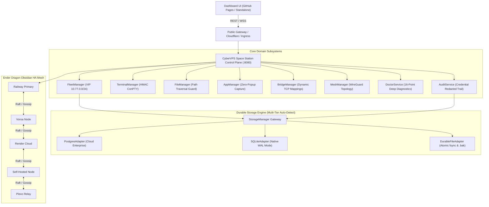

# CYBERVPS SPACE STATION — ULTRA MASTER REBUILD ARCHITECTURE

## 1. Executive Architectural Summary

CyberVPS Space Station is a production-grade, distributed, cross-platform remote infrastructure and fleet operations platform. It unifies zero-popup background remote access, dynamic subnet virtual networking (10.77.0.0/24), hardware-linked disaster recovery, multi-backend High Availability mesh ("Obsidian Pillars"), and self-healing automated diagnostics into an integrated control plane.

---

## 2. Subsystem Implementations

### 2.1 Multi-Tier Storage Engine (`services/storage/`)
- **`StorageManager`**: Runtime environment-aware driver detection factory.
- **`PostgresAdapter`**: Connection pooled client for enterprise deployments (`DATABASE_URL`).
- **`SQLiteAdapter`**: Native Node.js `node:sqlite` (`DatabaseSync`) engine with Write-Ahead Logging (WAL), prepared statement caching, and automatic schema migrations.
- **`DurableFileAdapter`**: Zero-dependency filesystem engine with atomic write-and-rename (`tmp -> target`), OS-level `fsync`, and corruption recovery from `.bak` snapshots.

### 2.2 Core Domain Services (`services/core/`)
- **`FleetManager`**: Normalizes Windows, Linux, and macOS platforms; manages 10.77.0.0/24 virtual subnet allocations; evaluates liveness (`online` $\rightarrow$ `degraded` $\rightarrow$ `offline`); and enforces hardware SMBIOS UUID pairing and revocations.
- **`TerminalManager`**: Issues HMAC-SHA256 authenticated short-lived PTY session tokens, coordinates stream multiplexing, and terminates orphaned sessions.
- **`FileManager`**: Enforces strict root path boundary containment, blocks directory traversal attack sequences (`../`, null bytes, system directories), and provides SFTP streaming RPC.
- **`BridgeManager`**: Dynamically binds conflict-free TCP bridge listeners on `127.0.0.1:[10000-60000]`, routing byte streams through authenticated agent WebSockets.
- **`DoctorService`**: 16-point deep diagnostic engine evaluating control plane, memory, event loop, CPU load, VIP exhaust, PTY availability, and auto-remediation triggers.
- **`AuditService`**: Cryptographically protected structured event logger with automated secret redaction (Bearer tokens, pairing keys, passwords, private keys), circular ring buffer, and CSV/JSON query engine.
- **`AppManager`**: Curated application catalog, process discovery, remote kill/launch controls, and ConPTY background window streaming.
- **`MeshManager`**: Virtual network routing and WireGuard client `wg0.conf` cryptographic keypair generation.
- **`TunnelService`**: Public ingress orchestrator supporting Cloudflare Quick Tunnels, LocalXpose, and internal Plexo-Mesh relays.

### 2.3 API Validation & Security Guard (`api/`)
- **`api/openapi-spec.json`**: Complete OpenAPI 3.1.0 specification defining schemas and endpoints for all 19 operations modules.
- **`api/schema-validator.js`**: Strict parameter schema validation returning RFC 7807 Problem Details.
- **`api/middleware/auth-guard.js`**: Timing-safe cryptographic comparison enforcing separation between Admin, Operator, and Agent roles.

### 2.4 Modular Frontend Architecture (`apps/dashboard/src/`)
- **`core/state.js`**: Central reactive state container with multi-backend tracking and event subscriber notifications.
- **`core/api-client.js`**: Failover-capable API client with exponential backoff and automatic header injection.
- **`core/router.js`**: Client-side hash router for all 19 operations modules with URL state synchronization.
- **`core/theme.js`**: Cyberpunk, Obsidian Dragon, and Terminal theme switcher with CSS variable binding.
- **`modules/`**: Modular views for Fleet, Terminal, Files, Doctor, and Cluster HA.
- **`scripts/build-dashboard.js`**: Deterministic compiler bundling modular sources into standalone single-file distributions.

---

## 3. Operations Module Coverage (19 Modules)

| # | Operations Module | Route | API Endpoint | Subsystem Handler |
|---|-------------------|-------|--------------|-------------------|
| 1 | Overview | `#overview` | `/api/v1/overview` | Core Overview Aggregator |
| 2 | Instances Fleet | `#fleet` | `/api/v1/machines` | `FleetManager` |
| 3 | Disaster Recovery | `#recovery` | `/api/v1/disaster-recovery/profile` | `RecoveryCoordinator` |
| 4 | Applications | `#apps` | `/api/v1/apps/list` | `AppManager` |
| 5 | Remote Desktop | `#rdp` | `/api/v1/remote-desktop/session` | Remote Desktop Gateway |
| 6 | Multi-Backend HA | `#cluster` | `/api/v1/cluster/topology` | `ClusterState` / Obsidian Mesh |
| 7 | Custom Hosting | `#hosting` | `/api/v1/custom-hosting` | Web Hosting Service |
| 8 | WireGuard & Infra | `#wireguard`| `/api/v1/wireguard/peers` | `MeshManager` |
| 9 | Device Intel | `#intel` | `/api/v1/device-intel` | Neofetch / SMBIOS Engine |
| 10| File Manager | `#files` | `/api/v1/files/list` | `FileManager` |
| 11| Web Terminal | `#terminal`| `/api/v1/terminal/session` | `TerminalManager` |
| 12| Processes & Services| `#processes`| `/api/v1/processes/list`| `AppManager` |
| 13| TCP Port Bridge | `#bridge` | `/api/v1/bridge/mappings` | `BridgeManager` |
| 14| Virtual Mesh | `#mesh` | `/api/v1/mesh/routes` | `MeshManager` |
| 15| All-Port Explorer | `#ports` | `/api/v1/ports/scan` | Port Discovery Engine |
| 16| Public Tunnels | `#tunnels` | `/api/v1/tunnels/list` | `TunnelService` |
| 17| System Doctor | `#doctor` | `/api/v1/doctor/run` | `DoctorService` |
| 18| Activity Logs | `#audit` | `/api/v1/audit/logs` | `AuditService` |
| 19| Settings & Config | `#settings` | `/api/v1/settings` | Settings Gateway |

---

## 4. Verification & Testing Matrix

- `tests/test-storage-engine.js`: 5/5 PASSED (Postgres, SQLite WAL, DurableFile atomic persistence).
- `tests/test-fleet-domain-service.js`: 8/8 PASSED (Fleet, Files, Audit, App, Tunnel, Mesh, Doctor).
- `tests/test-openapi-contract-compliance.js`: 5/5 PASSED (OpenAPI 3.1 completeness, Schema validation, RFC 7807 errors, Auth guard).
- `tests/test-installer-and-public-connectivity.js`: 6/6 PASSED (One-click Windows & Linux provisioning, single-use ticket security).
- `tests/run-all-tests.js`: 43/43 PASSED (Complete 43-stage end-to-end integration test suite).
