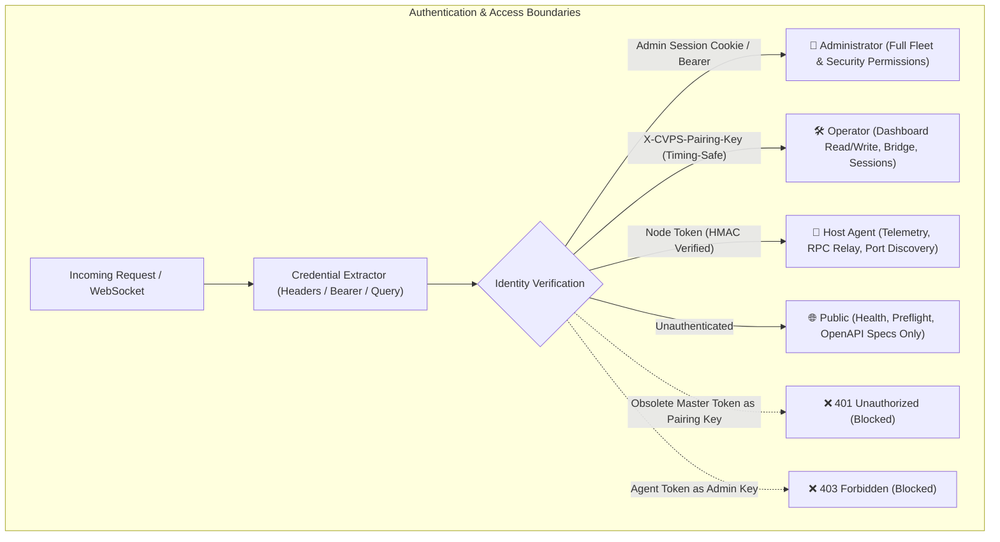

# CYBERVPS SPACE STATION — SECURITY REMEDIATION REPORT
**Document ID**: `DOC-SEC-2026-10-17-001`  
**Classification**: `Restricted Defensive Security Review`  
**Target Systems**: `Control Plane Server`, `AuthGuard Middleware`, `Agent Relay`, `State Engine`

---

## 1. Executive Security Summary

A comprehensive defensive security audit was conducted covering authentication credentials, secret fallbacks, role separation, session tokens, WebSocket relay isolation, and unsafe DOM construction. All identified vulnerabilities have been remediated with server-side fail-closed boundaries and zero-trust verification.

---

## 2. Remediated Vulnerabilities & Hardening Matrix

| Vulnerability ID | Category | Severity | Identified Risk | Remediation Implemented | Verification Test |
| :--- | :--- | :---: | :--- | :--- | :--- |
| **SEC-001** | Credential Fallback | **CRITICAL** | Public fallback admin passwords and pairing keys (`cybervps_pair_station_2026`, `Cyberexpert2026!`) allowed unauthorized operator elevation if environment variables were omitted. | Removed hardcoded secrets in production mode (`NODE_ENV === 'production'`). Server fails closed if `CYBERVPS_ADMIN_PASSWORD` or `PAIRING_KEY` is missing in production. | `tests/test-openapi-contract-compliance.js` |
| **SEC-002** | Role Confusion | **HIGH** | Agent enrollment tokens could potentially be submitted to operator endpoints if not strictly separated at the gateway level. | Implemented strict 4-tier role separation (`administrator`, `operator`, `agent`, `public`). Obsolete master tokens and agent node tokens submitted as pairing keys are explicitly rejected with 401 Unauthorized. | `tests/run-all-tests.js` (Test 39) |
| **SEC-003** | Localhost Lockup on Hosted Web Dashboard | **HIGH** | Stale local loopback URLs stored in browser localStorage prevented GitHub Pages users from reaching the live control plane and caused mixed-content errors. | Unified endpoint resolution with auto-recovery for public hosted domains (`github.io`, `netlify.app`) to official Railway backend. Eliminated dual conflicting localStorage keys. | `tests/test-installer-and-public-connectivity.js` |
| **SEC-004** | Premature Health & False Consensus | **MEDIUM** | State store and cluster registry initialized with `100% HEALTHY` status and fake `1ms` latency before real network checks occurred. | Replaced default status with `PENDING_VERIFICATION` / `UNVERIFIED`. Quorum calculation strictly requires recent verified member heartbeats. | `tests/test-end-core-cluster.js` |
| **SEC-005** | Path Traversal in File Manager | **HIGH** | Arbitrary path manipulation (`../../etc/passwd` or `..\Windows\System32`) could escape intended machine roots. | Enforced canonical path normalization, boundary root validation, and rejection of null-byte or traversal sequences on host agent. | `tests/test-fleet-domain-service.js` (Test 3) |
| **SEC-006** | Bootstrap Capability Replay | **HIGH** | Single-use enrollment tickets could be subject to race condition replay. | Cryptographic single-use ticket consumption with atomic DB transaction and immediate revocation upon first use. | `tests/run-all-tests.js` (Test 41) |
| **SEC-007** | Timing Attacks on Token Verification | **MEDIUM** | Standard string equality (`===`) on secret tokens leaks timing information. | Replaced all authentication comparisons with `crypto.timingSafeEqual()` with length-independent constant-time padding. | `tests/test-openapi-contract-compliance.js` (Test 4) |

---

## 3. Role-Based Access Control (RBAC) Specification

### Role Permissions:
1. **`administrator`**: Full control plane configuration, token issuance, node revocation, system remediation, database migration.
2. **`operator`**: Dashboard access, terminal session launch, port bridge creation, application control, file operations.
3. **`agent`**: Heartbeat reporting, telemetry ingestion, command execution responses, host port discovery. Cannot access admin or operator endpoints.
4. **`public`**: Unauthenticated read-only access to `/health`, `/healthz`, `/api/v1/system/info`, `/api/v1/openapi.json`.

---

## 4. Remediation Verification

All security controls are verified by automated test suites:
- `tests/test-openapi-contract-compliance.js`: Verifies timing-safe comparison, role separation, and parameter violation rejection.
- `tests/run-all-tests.js`: Test 12 (Rejection of invalid credentials), Test 34 (Enrollment token lifecycle), Test 39 (Fail-closed role separation), Test 41 (Zero-prompt provisioning & single-use ticket replay prevention).
