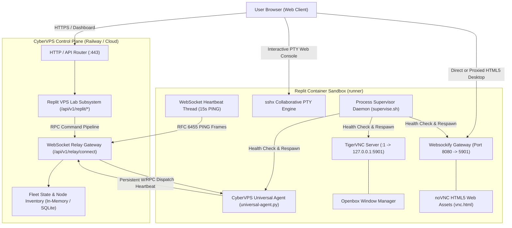

# CYBERVPS SPACE STATION × REPLIT VPS LAB: ARCHITECTURE & SYSTEM DESIGN

This document outlines the end-to-end architecture, communication flows, security model, and lifecycle controls of the **Replit VPS Lab** integration within the **CyberVPS Space Station** ecosystem.

---

## 1. SYSTEM TOPOLOGY

---

## 2. DATA PIPELINE & PROTOCOL SPECIFICATION

### A. Persistent Relay Protocol (RFC 6455 WebSocket)
- **Endpoint:** `wss://<control-plane>/api/v1/relay/connect`
- **Authentication:** Instant cryptographic HMAC-SHA256 Node Token derived from enrollment secret and machine ID.
- **Heartbeat:** Outbound Ping frame (`opcode 0x9`, payload `b"ping"`) emitted every 15 seconds.
- **Failover:** Round-robin backend pool failover with exponential backoff (`2s * 1.5 + jitter`) upon disconnection.

### B. noVNC HTML5 Graphical Desktop Pipeline
- **RFB Layer:** TigerVNC server listening exclusively on loopback `127.0.0.1:5901`.
- **WebSocket Bridge:** `websockify` translates binary RFB packets into WebSocket frames served at port `8080`.
- **Client Interface:** `noVNC` JavaScript client (`vnc.html`) renders desktop pixels directly into an HTML5 `<canvas>` with zero browser plugins required.

### C. sshx Collaborative Web Terminal
- **Tunnel:** Outbound TLS connection initiated to `sshx.io` broker.
- **PTY Session:** Spawns unprivileged bash shell connected to pseudo-terminal.
- **Coordination:** Real-time multi-cursor terminal sharing with link published to CyberVPS Space Station dashboard.

---

## 3. PROVIDER RESILIENCE & LIFECYCLE MANAGEMENT

| State | Detection Mechanism | Control Plane Response | Recovery Action |
|---|---|---|---|
| **Online (Active)** | Persistent WebSocket open + ping/pong ACK < 20s | Status: `online` | Stream telemetry & accept RPC |
| **Idle Warning** | No telemetry for > 40s (WebSocket dropped) | Status: `reconnecting` | Client attempts backoff reconnect |
| **Provider Paused** | Last seen > 90s on `replit` or `prepare.sh` | Status: `provider_paused` | Surface awake instructions & URL ping |
| **Node Offline** | Heartbeat stale > 180s on standard VM | Status: `offline` | Fail over to standby replica |
