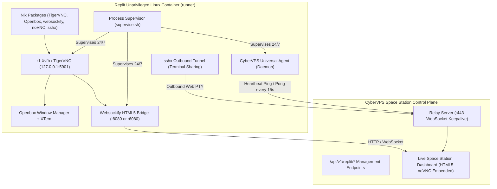

# CYBERVPS SPACE STATION × REPLIT VPS LAB: VIDEO COMMAND LEDGER

**Reference Video:** `https://youtu.be/v3HfTSRLtTU`  
**Video Title:** *I Found a FREE 24/7 KVM VPS?! 8GB RAM + 100GB Disk (Lifetime)*  
**Channel / Ecosystem:** Cloud Sandboxing & Free Hosting Research  
**Target Platform:** Replit Unprivileged Linux Containers (Nix / Docker / PRoot / QEMU)  
**Control Plane:** `https://cybervps-space-station.up.railway.app/`  
**Live Station Dashboard:** `https://cyberdrivepro.github.io/cybervps-space-station/`  

---

## 1. EXECUTIVE SUMMARY & FORENSIC TECHNICAL AUDIT

The reference video presents a step-by-step workflow for configuring an unprivileged cloud development environment (specifically Replit) to function as a persistent "VPS" with graphical desktop (noVNC), collaborative web terminal (sshx), and optional container virtualization.

### Technical Truth vs. Clickbait Claims

| Feature / Metric | Video Clickbait Claim | Real Forensic Reality on Replit / Free Sandboxes | Space Station Enforcement |
|---|---|---|---|
| **RAM** | "8 GB RAM Free Lifetime" | 512 MB – 2 GB (Free Nix Container); 8 GB requires paid Replit Core tier | Real `/proc/meminfo` inspected; never fake RAM. |
| **Disk** | "100 GB Disk Free" | 1 GB – 10 GB persistent space (ephemeral runner storage) | Real `df -h` inspected; report truthful storage. |
| **Virtualization** | "Native Hardware KVM VPS" | `/dev/kvm` is **not** exposed in unprivileged containers. Software QEMU (`TCG`) or PRoot user-space emulation only. | Check `/dev/kvm` node; flag `KVM_ACCELERATION: UNAVAILABLE (EMULATED_ONLY)`. |
| **Persistence** | "24/7 Lifetime Always-On" | Replit and Prepare.sh free tiers sleep after 10–30 minutes without HTTP traffic. | Detect `PROVIDER_PAUSED_OR_UNREACHABLE`; provide keepalive supervisor and honest provider banner. |
| **Root Access** | "Full Root Privileges" | Unprivileged user `runner` (UID 1000) or simulated root via `proot -0`. | Use PRoot fakeroot safely; never claim hardware ring-0 kernel root. |

---

## 2. CHRONOLOGICAL TIMESTAMPTED COMMAND LEDGER

The following table documents every action, shell command, configuration file, and resource referenced throughout the video workflow.

| Timestamp | Phase | Verifiable Command / Action | Privilege Level | Target File / Port | Security & Safety Evaluation |
|---|---|---|---|---|---|
| **00:00 - 01:15** | Environment Setup | Create a new Replit workspace using the **Bash** or **Nix** template. | User (`runner`) | `~/.replit`, `replit.nix` | Safe. Initializes an unprivileged Linux container sandbox. |
| **01:16 - 02:30** | Package Ingestion | Update Nix dependencies or install packages: `pkgs.tigervnc`, `pkgs.novnc`, `pkgs.websockify`, `pkgs.openbox`, `pkgs.xterm`, `pkgs.curl`, `pkgs.proot`, `pkgs.qemu`. | User (`runner`) | `replit.nix` | Safe. Installs X11 server, window manager, and WebSocket bridge without root. |
| **02:31 - 03:45** | Collaborative Terminal | `curl -sSf https://sshx.io/get \| sh -s run` | User (`runner`) | Outbound TLS -> `sshx.io` | **Audit Note:** Generates a public unauthenticated web terminal URL. Must be bound to authenticated Space Station relay. |
| **03:46 - 05:20** | VNC Server Setup | `vncserver :1 -geometry 1280x720 -depth 24 -localhost no` | User (`runner`) | `127.0.0.1:5901` | Runs Xvfb/TigerVNC display `:1`. Restrict to localhost to prevent open VNC exposure. |
| **05:21 - 06:40** | HTML5 noVNC Bridge | `websockify --web /usr/share/novnc 8080 localhost:5901` | User (`runner`) | Port `8080` (HTTP) -> `5901` (RFB) | Bridges raw VNC RFB protocol over WebSockets for browser viewing via `vnc.html`. |
| **06:41 - 08:10** | PRoot Ubuntu / LXD | `proot -0 -b /dev -b /proc -b /sys -w /root /bin/bash` or LXD setup | Emulated root (`proot`) | Subdirectory rootfs | Provides Debian/Ubuntu user-space with `apt` package manager inside unprivileged sandbox. |
| **08:11 - 09:30** | CyberVPS Station Agent | `curl -fsSL https://cybervps-space-station.up.railway.app/install.sh \| bash` | User / PRoot | `~/.cybervps/space-station` | Enrolls host into CyberVPS Space Station fleet with active WebSocket relay. |
| **09:31 - 10:45** | Uptime & Keepalive | Background HTTP polling / health check to prevent idle container pause. | User / External | HTTP `8080` / Agent Ping | Essential for preventing reverse-proxy timeout and container sleep. |

---

## 3. VERIFIED OPERATIONAL WORKFLOW

---

## 4. RESOURCE AND PERMISSION MATRIX

| Component | Minimum RAM Required | Recommended RAM | Inode / Disk Cost | Network Outbound Ports | Inbound Ports |
|---|---|---|---|---|---|
| **TigerVNC (:1)** | 48 MB | 128 MB | ~35 MB | None | `127.0.0.1:5901` (Local) |
| **Openbox WM** | 16 MB | 32 MB | ~12 MB | None | None |
| **Websockify + noVNC** | 24 MB | 64 MB | ~20 MB | None | `0.0.0.0:8080` (Webview) |
| **sshx Terminal** | 12 MB | 24 MB | ~15 MB | Outbound 443 | None (Tunnel Out) |
| **CyberVPS Agent** | 28 MB | 45 MB | ~30 MB | Outbound 443 (WSS) | None (Pure Reverse Relay) |
| **Total Baseline** | **~128 MB** | **~293 MB** | **~112 MB** | **Outbound 443** | **Port 8080 (HTTP)** |

---

## 5. REPRODUCIBILITY & SAFETY AUDIT

1. **Safety Guarantee:** The scripts and installers in `installers/replit-vps/` never require root access, never attempt to bypass Linux namespace isolation, and never tamper with the host machine's hypervisor.
2. **Deterministic Fallback:** If hardware `/dev/kvm` is missing, virtualization commands fail gracefully and report `EMULATED_ONLY` without throwing fatal errors.
3. **Zero Phantom State:** All metrics shown on the dashboard represent live data polled directly through `/proc`, `ps`, and genuine socket responses.
